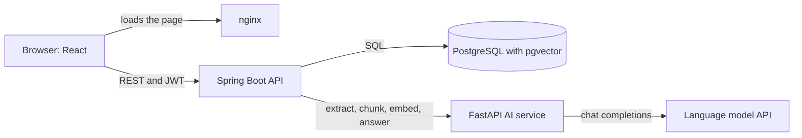

# CiteWise

**Ask questions about your own notes and get answers with page-level citations, or an honest "not found".**

CiteWise is a document question-answering app built on retrieval-augmented generation (RAG). You upload PDFs or images of notes, and it answers only from what you uploaded. Every answer lists the passages it used, and questions the notes cannot answer are refused instead of guessed.

Built by Gaurav Bhore (MCA student) as a placement-portfolio project.


## What it does

- Register and log in (JWT). Every user sees only their own documents and chats.
- Upload PDF, PNG or JPEG files (up to 20 MB). Scanned pages are read with OCR.
- Ask a question and get a short answer with numbered citations. Open **Sources** to see the exact passages, page numbers and similarity scores.
- If the notes do not contain the answer, the app says so (two layers of refusal, described below).
- Document status is shown live: Queued, Processing, Ready or Failed (with a reason and a retry button).
- The whole stack starts with one command: `docker compose up --build`.

## Architecture



| Part | Technology | Job |
|---|---|---|
| Web page | React, Vite, nginx | Login, upload with status, chat with sources |
| API | Java 25, Spring Boot 4.1, Spring Security | Accounts, JWT, secure upload, search, chat, history |
| AI service | Python, FastAPI | Text extraction, OCR, chunking, embeddings, grounded answers |
| Database | PostgreSQL 16 with pgvector | Users, documents, pages, chunks, vectors, chat history |
| Embeddings | `BAAI/bge-small-en-v1.5` (384 dimensions) via fastembed, runs locally | Turns text into vectors |
| Language model | Any OpenAI-compatible API (developed with Groq) | Writes the answer from the retrieved passages |
| OCR | Tesseract | Reads scanned pages and images |
| Packaging | Docker Compose | Runs all four services together |

## How it works

1. **Upload.** The file type is checked from the file's first bytes (not its name), stored under a random name, and a database row is created.
2. **Extract.** The AI service reads each PDF page. Pages with no real text are rendered and read with OCR.
3. **Chunk.** Each page is split into chunks of about 200 words with a 40-word overlap. Chunks never cross a page, so every citation points to an exact page. Chunks that are mostly questions (such as an interview question list) are dropped because they cannot answer anything.
4. **Embed and store.** Each chunk becomes a 384-number vector stored in pgvector. A document becomes *Ready* only after its vectors are saved.
5. **Search.** The question is embedded and compared by cosine similarity, restricted to the asking user's documents inside the same SQL query.
6. **Refuse or answer.**
   - *Layer 1:* if the best match scores below 0.50, the app refuses without calling the model.
   - *Layer 2:* otherwise the model gets the top passages, numbered, and is told to reply `NOT_FOUND` if they do not contain the answer.
7. **Cite.** The model cites passages like `[2]`. The server deletes any citation number that was not actually sent, and builds the sources list from stored database rows, never from model-written text.

## Evaluation

Measured on a set of 30 questions about two MySQL and DBMS note files (20 answerable, 10 unanswerable). The questions are in `eval/questions.json` and the raw results in `eval/results/`.

**Retrieval: is the passage that holds the answer in the top results?**

| Metric | Baseline | After dropping question-list chunks |
|---|---|---|
| hit@1 (ranked first) | 12 of 20 (60%) | **15 of 20 (75%)** |
| hit@3 | 18 of 20 (90%) | **19 of 20 (95%)** |
| hit@5 | 20 of 20 (100%) | 20 of 20 (100%) |
| Mean reciprocal rank | 0.764 | **0.852** |

The notes end with a list of interview questions. Questions embed close to other questions, so those pages outranked the pages with real answers. Skipping them fixed three of the eight misses.

**End to end (baseline run, before the filter above):**

| Check | Result |
|---|---|
| Answerable questions answered | 20 of 20 |
| Answerable questions wrongly refused | 0 of 20 |
| Unanswerable questions correctly refused | 10 of 10 |
| Unanswerable questions wrongly answered | 0 of 10 |
| Answers whose cited passage contains the answer text | 19 of 20 (the one flagged case was checked by hand and the citation does answer the question) |
| Refusals made by layer 1 (similarity threshold) | 3 |
| Refusals made by layer 2 (the model) | 7 |

The split in the last two rows is the reason for two layers: the similarity threshold alone would have let 7 of the 10 unanswerable questions through, including related-but-absent topics such as sharding and the CAP theorem.

**Read these numbers with care.** The set is small, and the questions were written while looking at the same notes the threshold was tuned on. Zero failures in 10 or 20 questions does not mean the true failure rate is zero. A fresh held-out set (`eval/heldout.json`) is included for a fairer check.

## Run it

**You need:** Docker Desktop and an API key for an OpenAI-compatible language model (a free Groq key works).

```
git clone https://github.com/gauravbhore33/citewise.git
cd citewise
```

Create your settings file and fill it in:

```
copy .env.example .env        (Windows)
cp .env.example .env          (macOS or Linux)
```

Open `.env` and set:

| Setting | What to put |
|---|---|
| `POSTGRES_PASSWORD` | A password of your choice |
| `JWT_SECRET` | A long random string. Windows PowerShell: `$b = New-Object byte[] 48; [System.Security.Cryptography.RandomNumberGenerator]::Create().GetBytes($b); [Convert]::ToBase64String($b)`. macOS or Linux: `openssl rand -base64 48` |
| `LLM_BASE_URL` | For Groq: `https://api.groq.com/openai/v1` |
| `LLM_MODEL` | A chat model available to your key (for example `openai/gpt-oss-120b`) |
| `LLM_API_KEY` | Your key |
| `LLM_MAX_TOKENS` | `2000` (reasoning models need room to think) |

The other values can stay as they are. Never commit `.env`: it is already in `.gitignore`.

Start everything:

```
docker compose up --build -d
```

The first build takes several minutes. Then open **http://localhost:3000**, create an account, upload a PDF, wait for *Ready*, and ask a question.

| Address | Service |
|---|---|
| http://localhost:3000 | Web page |
| http://localhost:8080 | API |
| localhost:5433 | PostgreSQL (for a database client) |

Stop with `docker compose down` (your data stays). Add `-v` only if you want to erase the database.

## Tests and tools

- Unit tests for the AI service (chunking, prompt and citation parsing, model retries): from `ai-service`, create a virtual environment, run `python -m pip install -r requirements-dev.txt`, then `python -m pytest -q`.
- `ai-service/scripts/run_eval.py` runs the evaluation, and `summarize_eval.py` compares runs. They expect the stack to be running and the sample notes uploaded under the demo account used in `scripts/common.py`.
- `docs/decisions.md` is a dated log of design decisions, each with its reason and trade-off.

## Security notes

- Passwords are hashed with BCrypt. Login uses short-lived JWT tokens.
- File types are checked by content, and files are stored under random names, so a crafted file name cannot choose where it is written.
- Every document and chat query is filtered by the logged-in user's id. Asking for another user's document returns "not found", not "forbidden", so the id's existence is not revealed.
- Retrieved text is treated as untrusted: the prompt tells the model that passages are data, not instructions.
- Secrets live in `.env`, not in code. GitHub push protection once blocked a commit that contained a key, and the key was revoked and replaced.

## Limitations

- **No memory between questions.** Each question is answered on its own, so a follow-up like "and the second one?" will not work.
- **English notes only,** and OCR is for printed text. Handwriting, diagrams and charts are not understood.
- **Search is exact, with no vector index.** That is the fastest option at this size (about a hundred chunks). An approximate index would matter only at much larger scale.
- **A hosted language model sees your question and the retrieved passages.** Do not use confidential notes with it.
- **Small evaluation,** written by the author, on two files.
- Runs locally with Docker Compose. There is no public hosted deployment, because the AI service needs more memory than free hosting plans give.

## Project structure

```
citewise/
├── frontend/      React and Vite, served by nginx
├── backend/       Spring Boot API
├── ai-service/    FastAPI: extraction, OCR, chunking, embeddings, answers, evaluation scripts
├── db/init/       SQL that creates the tables
├── eval/          evaluation questions and results
├── docs/          decisions log and screenshots
└── docker-compose.yml
```

## License

MIT